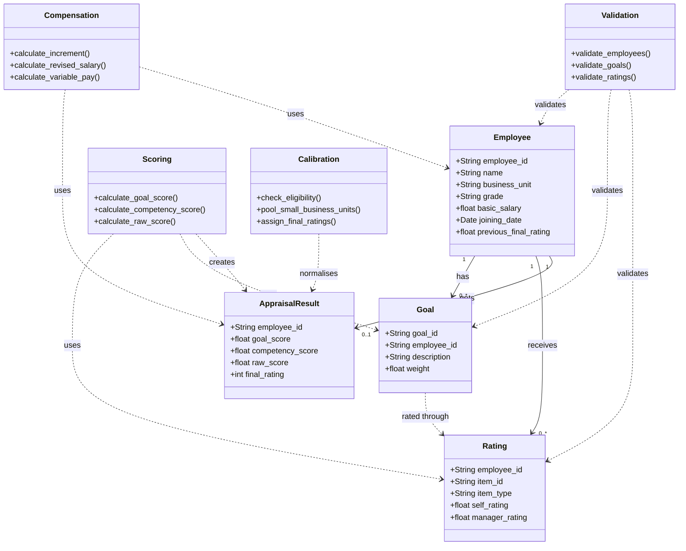

# UML Class Diagram

## Purpose

The class diagram represents the main data models and processing components of the Performance Appraisal and Bell-Curve Normalisation system. It shows how employee details, goals, ratings, appraisal scores, calibration and compensation are connected.

## Class Diagram

## Explanation

1. **Employee:** Stores employee details such as ID, name, business unit, grade, salary and joining date.
2. **Goal:** Stores the goals assigned to each employee and their weights.
3. **Rating:** Stores self-ratings and manager ratings for goals and competencies.
4. **AppraisalResult:** Stores the calculated goal score, competency score, raw score and final rating.
5. **Validation:** Checks whether the input data is complete and follows the required rules.
6. **Scoring:** Calculates goal scores, competency scores and the final raw appraisal score.
7. **Calibration:** Applies eligibility rules and bell-curve normalisation to assign final ratings.
8. **Compensation:** Calculates increments, revised salaries and variable pay based on appraisal results.

## Note

This is the design-level class diagram. Some components, such as `AppraisalResult` and the processing classes, represent planned logical responsibilities and may be implemented as Python functions or modules rather than separate classes.