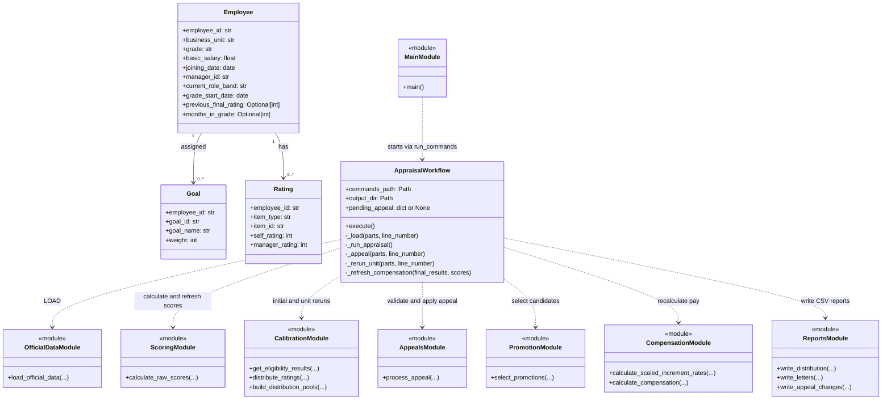

# Implemented Class and Module Diagram

The diagram distinguishes the implemented data classes and workflow class from
the processing modules. Scores, calibration results, and compensation results
are dictionaries in the implementation; they are not separate model classes.

`commands.txt` is a line-oriented input read by `AppraisalWorkflow.execute()`;
it is not represented as a Python data class. The workflow processes settings,
`LOAD`, `RUN_APPRAISAL`, `APPEAL`, `RERUN_UNIT`, and print commands in file
order. The current working assumption advances a promotion to the next grade
in `grade_bands.csv` order; this progression is awaiting Capstone confirmation.
After a successful promotion, the confirmed rule sets `months_in_grade` to
zero. See the [decision log](decision_log.md).
