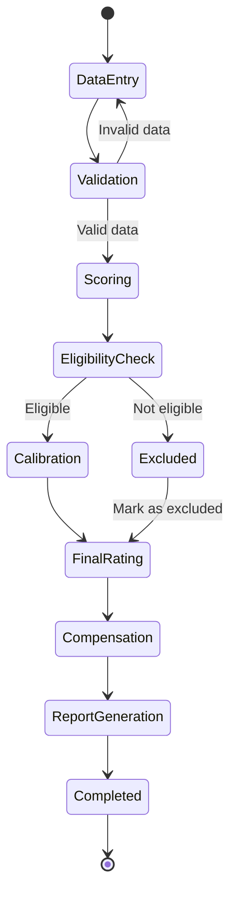

# UML State Diagram

## Purpose

The state diagram shows the different stages of the employee performance appraisal process. It explains how an appraisal moves from initial data entry to validation, score calculation, calibration and final compensation.

## State Diagram

## Explanation of States

1. **Data Entry:** Employee details, goals, ratings and budget information are provided through CSV files.
2. **Validation:** The system checks whether the input data is complete and follows the required rules.
3. **Scoring:** Goal scores, competency scores and raw appraisal scores are calculated.
4. **Eligibility Check:** The system checks whether an employee is eligible for the appraisal cycle.
5. **Excluded:** Employees who do not meet eligibility conditions are excluded from bell-curve calibration.
6. **Calibration:** Eligible employees are grouped and assigned final ratings using the bell-curve distribution.
7. **Final Rating:** The employee's final appraisal rating is recorded.
8. **Compensation:** Increment, revised salary and variable pay are calculated according to the applicable rules.
9. **Report Generation:** The system prepares the final appraisal results.
10. **Completed:** The appraisal process is finished.

## Note

This diagram represents the overall planned workflow of the system. Some stages may be implemented as Python functions rather than separate classes or independent software states.