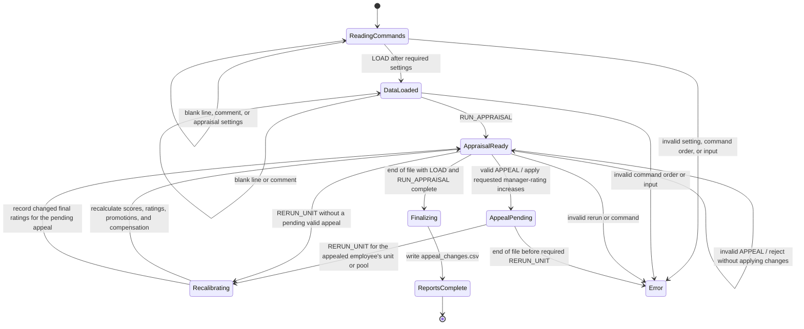

# Implemented Command-Workflow State Diagram

The workflow reads non-comment commands in file order. Settings must precede
`LOAD`; `RUN_APPRAISAL` requires loaded data. A valid appeal must be followed
by a rerun of the affected unit or pool before another appeal or end-of-file.

Each `PRINT_DISTRIBUTION|ALL` appends a numbered snapshot in command order.
`PRINT_LETTERS|ALL` writes the current employee results. A rerun refreshes
compensation after recalibration. Rejected appeals do not mutate ratings.